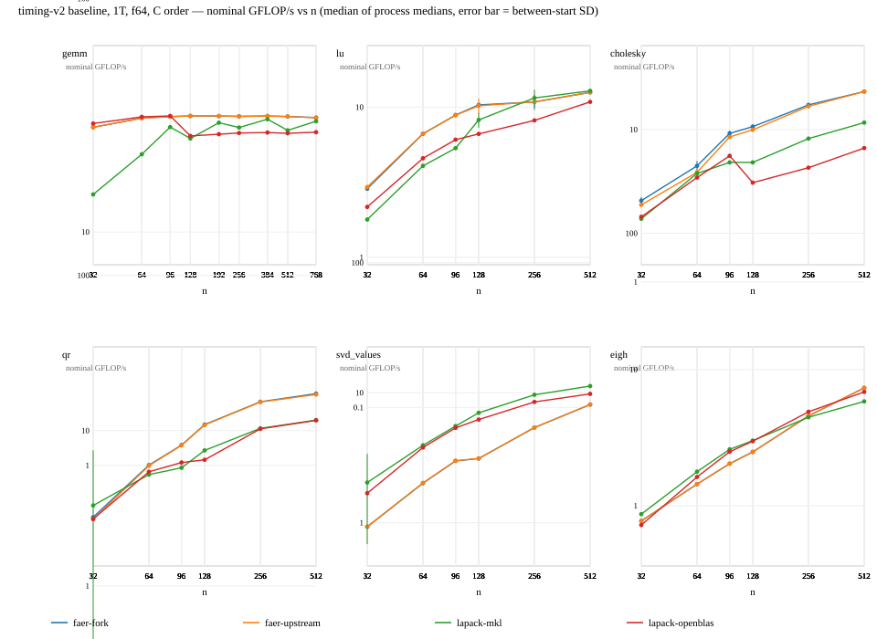
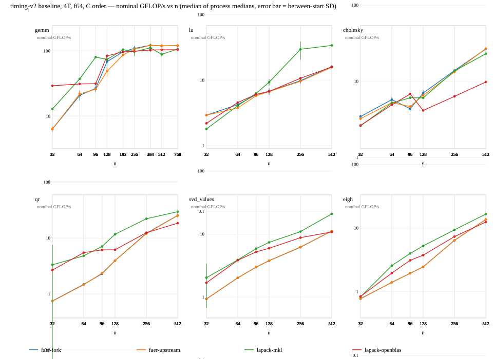
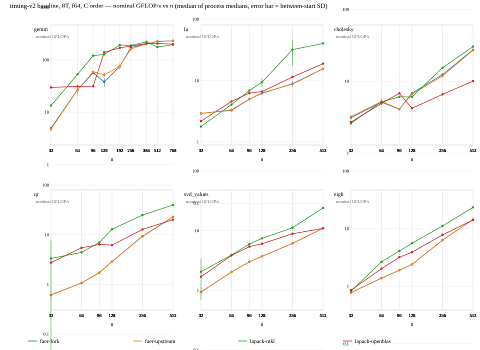

# Throughput prototype (visual check only)

Generated from the recorded daily-suite runs; no timing was run. **Nominal** GFLOP/s with one
algorithmic operation count per family (GEMM 2n^3, LU 2n^3/3, Cholesky n^3/3, QR 8n^3/3 with Q,
SVD values 4n^3, self-adjoint EVD 8n^3/3), median of process medians, error bar = between-start
sample SD, C order, f64, one panel per family and one SVG per thread budget.

### 1T

### 4T

### 8T

The `lapack-openblas` line comes from the other arm (a separate binary), so its absolute
level carries the between-arm uncertainty; `faer-fork`/`faer-upstream`/`lapack-mkl` are one
process. Sizes above 768 need the `faer-kernels-large` suite (4T/8T only).
