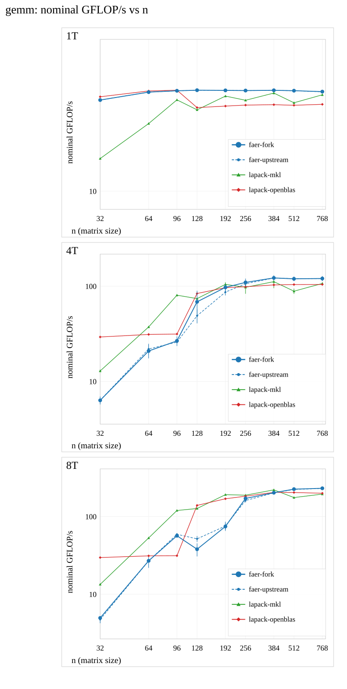
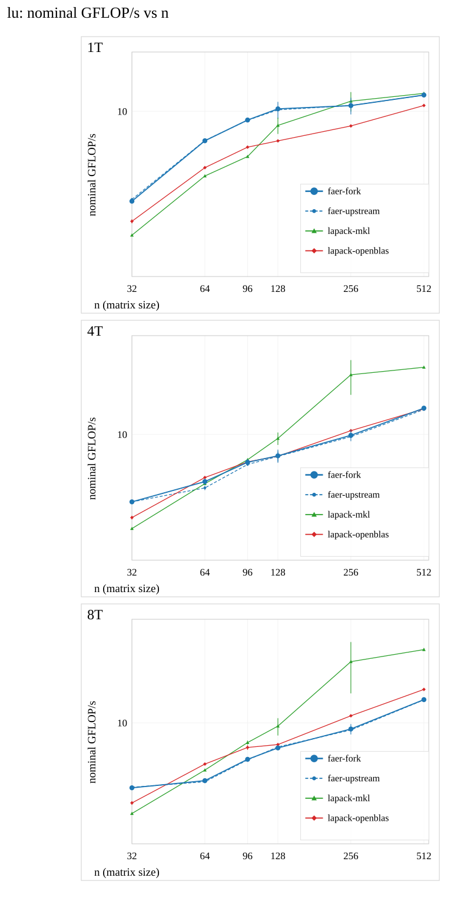
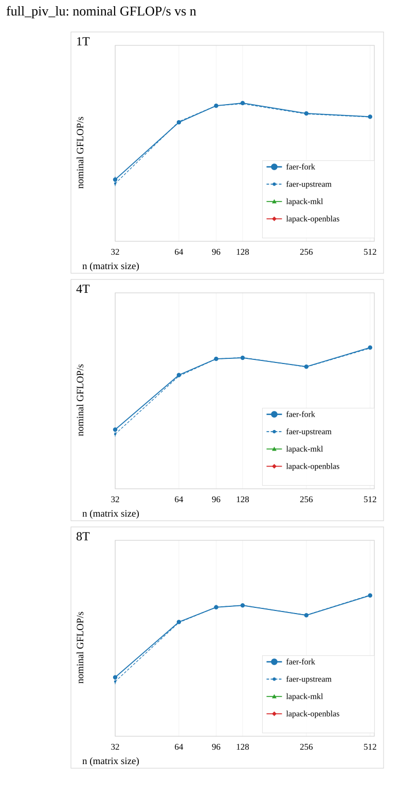
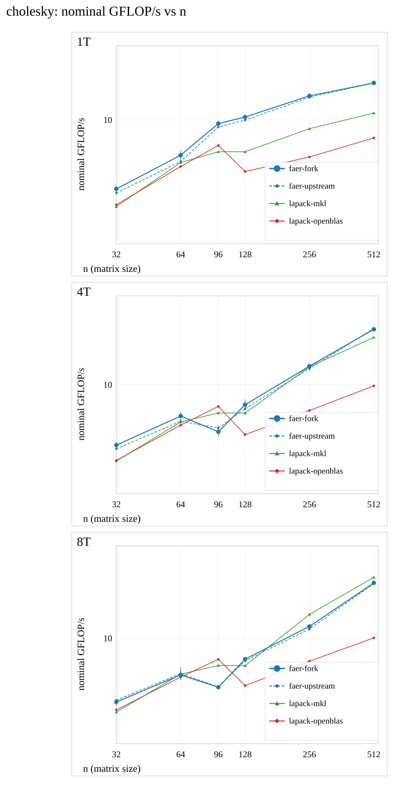
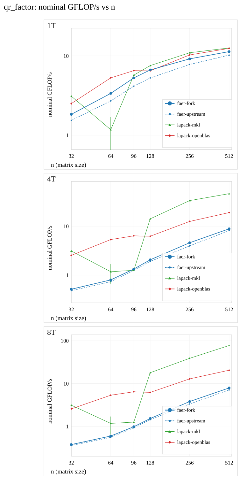
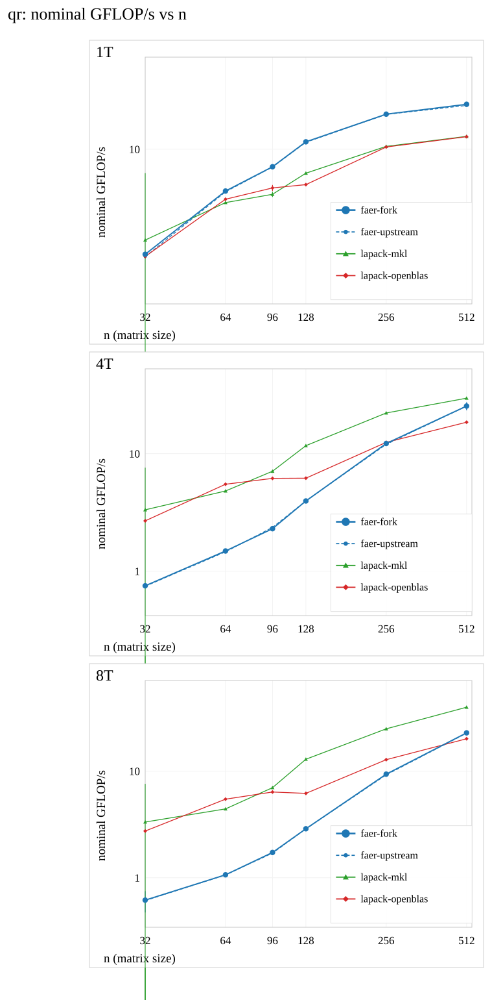
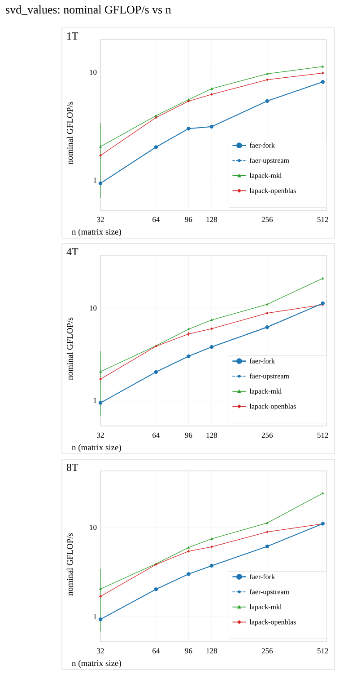
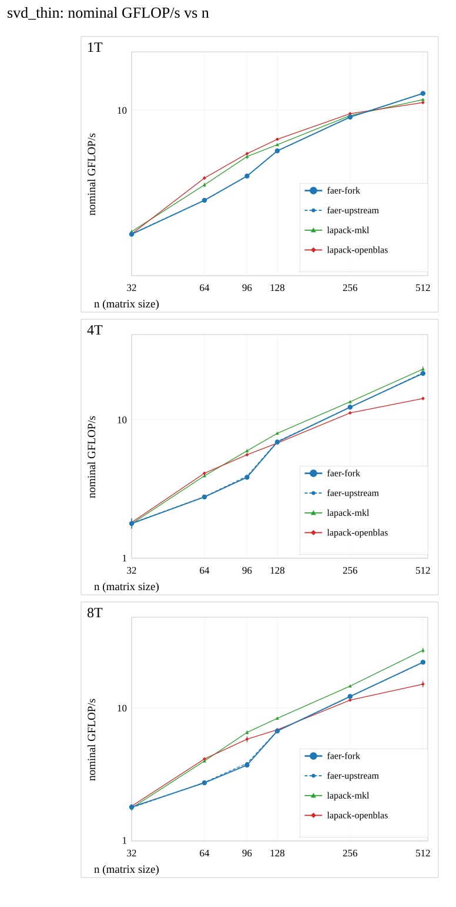
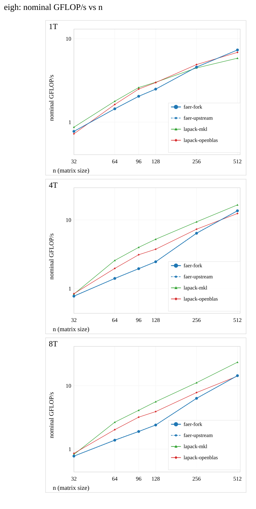

# Throughput charts (prototype, visual check only)

Recorded daily-suite data only; no timing was run and nothing is published. One file per
family, one panel per thread budget (1T measured 32-768; 4T/8T will extend to 1536 once
`faer-kernels-large` is recorded). Error bars are the between-start sample SD of the process
medians. GFLOP/s is **nominal**: one algorithmic operation count per family, so absolute
values are not comparable across families. The `lapack-openblas` line comes from the other
arm (its own binary, its own processes); the other three share one process.

## Contents

| family | nominal flops | points per budget |
|---|---|---|
| [gemm](throughput-gemm-v4.svg) | `2n^3` | 1T: 9, 4T: 9, 8T: 9 |
| [lu](throughput-lu-v4.svg) | `2n^3/3` | 1T: 6, 4T: 6, 8T: 6 |
| [full_piv_lu](throughput-full_piv_lu-v4.svg) | `2n^3/3` | 1T: 6, 4T: 6, 8T: 6 |
| [cholesky](throughput-cholesky-v4.svg) | `n^3/3` | 1T: 6, 4T: 6, 8T: 6 |
| [qr_factor](throughput-qr_factor-v4.svg) | `4n^3/3` | 1T: 6, 4T: 6, 8T: 6 |
| [qr](throughput-qr-v4.svg) | `8n^3/3 (factor + Q)` | 1T: 6, 4T: 6, 8T: 6 |
| [svd_values](throughput-svd_values-v4.svg) | `4n^3` | 1T: 6, 4T: 6, 8T: 6 |
| [svd_thin](throughput-svd_thin-v4.svg) | `~10n^3 (Golub-Kahan, implementation dependent)` | 1T: 6, 4T: 6, 8T: 6 |
| [eigh](throughput-eigh-v4.svg) | `8n^3/3` | 1T: 6, 4T: 6, 8T: 6 |

## gemm

Nominal operation count: `2n^3`.

## lu

Nominal operation count: `2n^3/3`.

## full_piv_lu

Nominal operation count: `2n^3/3`.

## cholesky

Nominal operation count: `n^3/3`.

## qr_factor

Nominal operation count: `4n^3/3`.

## qr

Nominal operation count: `8n^3/3 (factor + Q)`.

## svd_values

Nominal operation count: `4n^3`.

## svd_thin

Nominal operation count: `~10n^3 (Golub-Kahan, implementation dependent)`.

## eigh

Nominal operation count: `8n^3/3`.

Layout is checked by the script: no label may overlap another or leave its panel.
