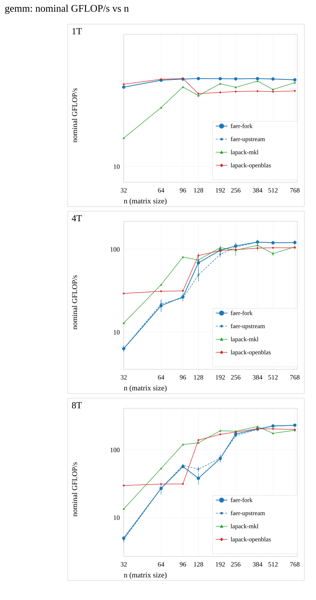
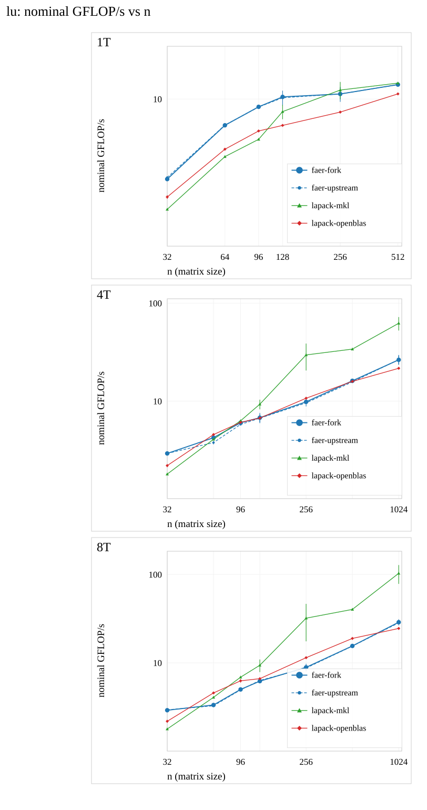
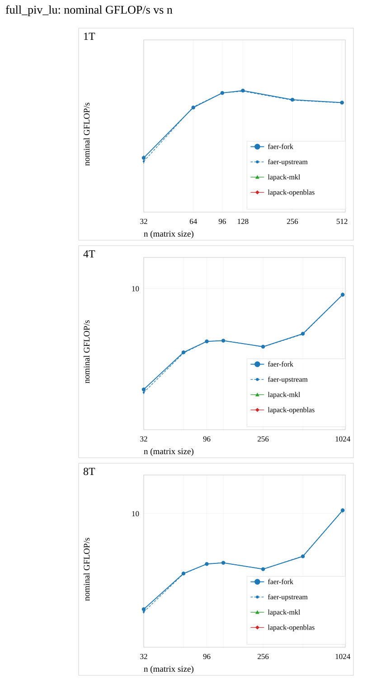
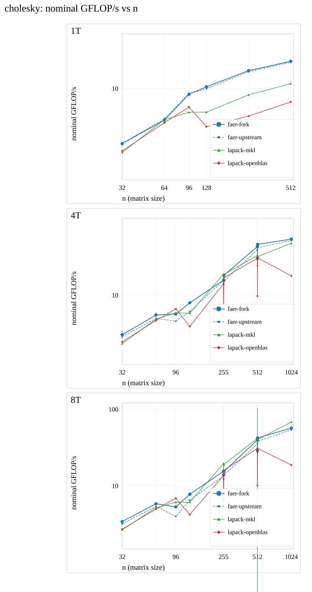
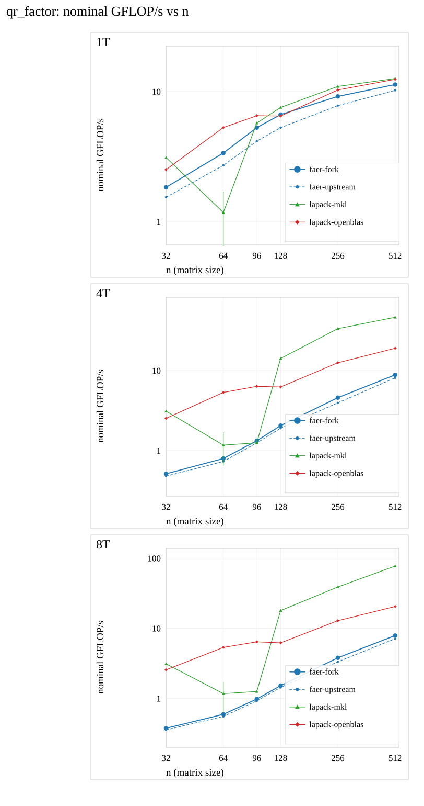
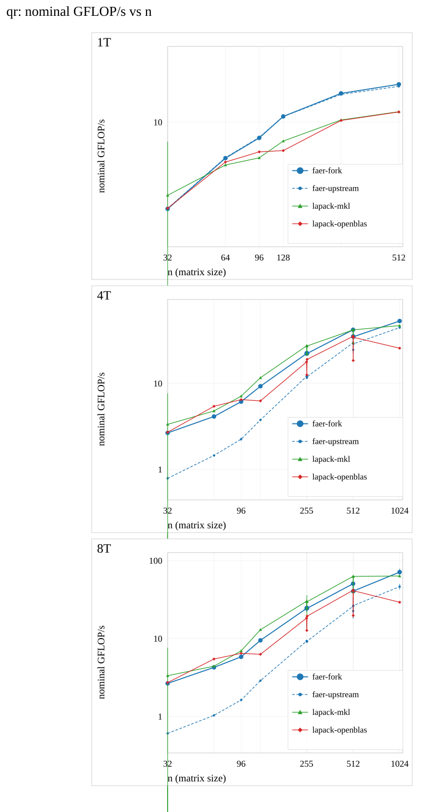
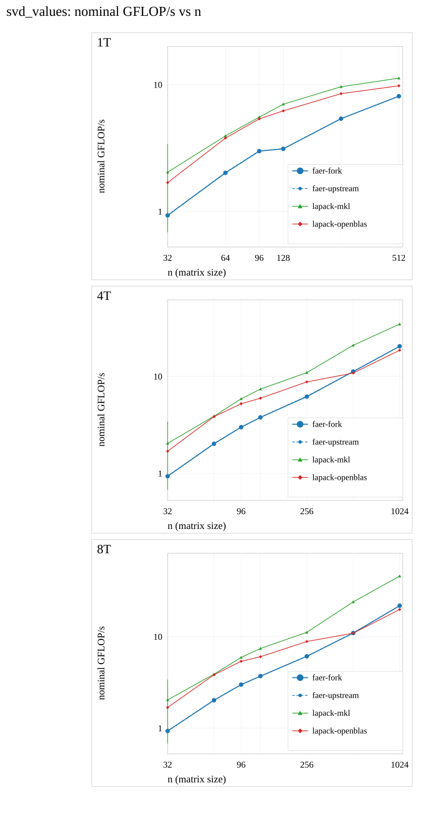
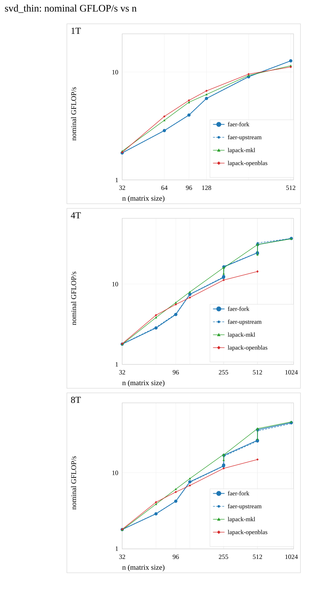
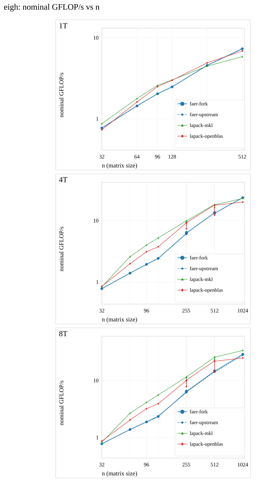

# Throughput charts - timing-v2 baseline (faer-kernels)

Generated by `scripts/throughput_report.py` from the recorded runs below; no timing is run here.
**Nominal** GFLOP/s: one algorithmic operation count per family, so sizes are comparable within a family and absolute values are not comparable across families. The count is stated under every chart and in each data table.
Error bars are the between-start sample SD of the process medians, not a confidence interval. The `!` cells of the measured pages are included as they were recorded.
`faer-fork`, `faer-upstream` and `lapack-mkl` come from one recorded run and therefore from one process each; `lapack-openblas` comes from the other arm (its own binary), so its absolute level carries the between-arm uncertainty.
1T is measured on the sizes the daily suite declares (32-768); 4T and 8T extend to 1536 once `faer-kernels-large` is recorded. A line stops where a size was not measured - nothing is interpolated.

## Contents

| family (chart, data) | nominal flops |
|---|---|
| [gemm](throughput-gemm-v2.svg) ([data](throughput-gemm-v2.md)) | `2n^3` |
| [lu](throughput-lu-v2.svg) ([data](throughput-lu-v2.md)) | `2n^3/3` |
| [full_piv_lu](throughput-full_piv_lu-v2.svg) ([data](throughput-full_piv_lu-v2.md)) | `2n^3/3 (no vendor row: unsupported)` |
| [cholesky](throughput-cholesky-v2.svg) ([data](throughput-cholesky-v2.md)) | `n^3/3` |
| [qr_factor](throughput-qr_factor-v2.svg) ([data](throughput-qr_factor-v2.md)) | `4n^3/3 (compact factors)` |
| [qr](throughput-qr-v2.svg) ([data](throughput-qr-v2.md)) | `8n^3/3 (factors and explicit Q)` |
| [svd_values](throughput-svd_values-v2.svg) ([data](throughput-svd_values-v2.md)) | `4n^3 (singular values only)` |
| [svd_thin](throughput-svd_thin-v2.svg) ([data](throughput-svd_thin-v2.md)) | `~10n^3 (Golub-Kahan, implementation dependent)` |
| [eigh](throughput-eigh-v2.svg) ([data](throughput-eigh-v2.md)) | `8n^3/3 (self-adjoint, vectors)` |

## gemm

Plotted numbers: [throughput-gemm-v2.md](throughput-gemm-v2.md). Nominal operation count `2n^3`.

## lu

Plotted numbers: [throughput-lu-v2.md](throughput-lu-v2.md). Nominal operation count `2n^3/3`.

## full_piv_lu

Plotted numbers: [throughput-full_piv_lu-v2.md](throughput-full_piv_lu-v2.md). Nominal operation count `2n^3/3 (no vendor row: unsupported)`.

## cholesky

Plotted numbers: [throughput-cholesky-v2.md](throughput-cholesky-v2.md). Nominal operation count `n^3/3`.

## qr_factor

Plotted numbers: [throughput-qr_factor-v2.md](throughput-qr_factor-v2.md). Nominal operation count `4n^3/3 (compact factors)`.

## qr

Plotted numbers: [throughput-qr-v2.md](throughput-qr-v2.md). Nominal operation count `8n^3/3 (factors and explicit Q)`.

## svd_values

Plotted numbers: [throughput-svd_values-v2.md](throughput-svd_values-v2.md). Nominal operation count `4n^3 (singular values only)`.

## svd_thin

Plotted numbers: [throughput-svd_thin-v2.md](throughput-svd_thin-v2.md). Nominal operation count `~10n^3 (Golub-Kahan, implementation dependent)`.

## eigh

Plotted numbers: [throughput-eigh-v2.md](throughput-eigh-v2.md). Nominal operation count `8n^3/3 (self-adjoint, vectors)`.

